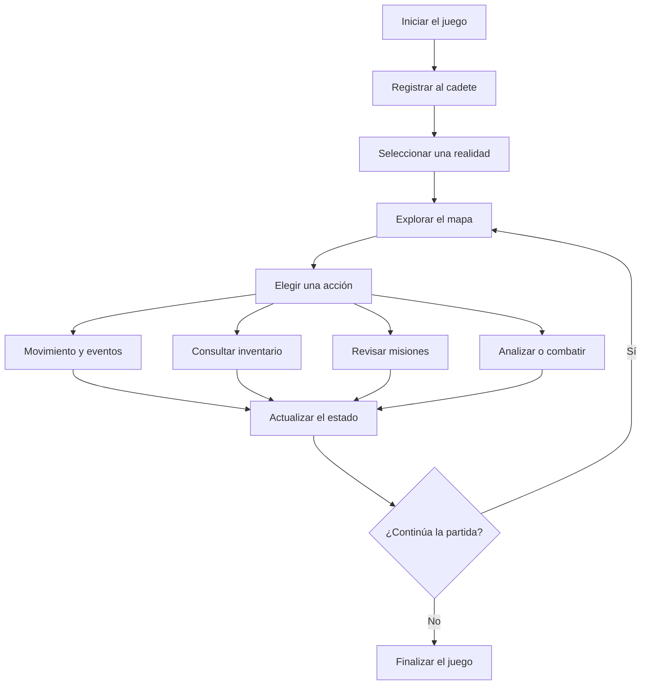

# Arquitectura actual de NEXUS

## 1. Descripción general

NEXUS es un juego desarrollado en C# que funciona desde la consola. El proyecto está basado en programación orientada a objetos y permite explorar diferentes realidades IRIS, completar misiones, combatir enemigos y administrar los recursos del cadete.

La mayor parte del funcionamiento del juego se encuentra en `Program.cs`, donde están definidas las clases y las mecánicas principales. Para interactuar con el sistema se utiliza el teclado, mientras que la información se muestra mediante textos, colores y símbolos.

## 2. Estructura del proyecto

El proyecto está organizado en varios archivos y carpetas que cumplen diferentes funciones:

- `Program.cs`: contiene gran parte del código del juego, como las clases, los personajes, el combate, las misiones y la exploración.
- `NexusPOO.csproj`: contiene la configuración necesaria para compilar y ejecutar el proyecto.
- `Frames/`: carpeta destinada a los recursos de texto que se utilizan en la presentación del juego.
- `Sonidos/`: contiene archivos de audio que acompañan algunas partes del juego.
- `docs/`: contiene documentos relacionados con el proyecto.

Actualmente, varias funciones están concentradas en un solo archivo. Esto permite tener el código reunido, aunque a medida que el juego crezca podría resultar más difícil encontrar y modificar algunas partes.

## 3. Componentes principales

### 3.1. Interfaz de consola

La clase `Ui` se encarga de la presentación del juego. Tiene métodos para centrar textos, mostrar títulos, crear marcos, cambiar colores y representar barras de estado.

Gracias a esta clase, la información se presenta de forma más ordenada y se mantiene un estilo parecido en las diferentes partes del juego.

### 3.2. Personajes

La clase abstracta `Personaje` sirve como base para los personajes del juego. Contiene características comunes, como el nombre, la energía y los comportamientos relacionados con el daño y los turnos.

A partir de ella se encuentran otras clases:

- **Cadete:** es el personaje controlado por el jugador. Tiene energía, estabilidad, escudo, experiencia y diferentes acciones que puede realizar durante la partida.
- **Robot:** es una entidad con capacidades defensivas y habilidades propias.
- **Enemigo:** representa las entidades hostiles que pueden aparecer durante la exploración y los encuentros.

Esta organización permite compartir características entre personajes sin que todos tengan que comportarse de la misma manera.

### 3.3. Exploración de mapas

El juego permite seleccionar entre las realidades IRIS-01, IRIS-02 e IRIS-03 y recorrer sus mapas utilizando WASD o las flechas del teclado.

Los mapas están representados mediante símbolos que identifican diferentes elementos del entorno. Algunos terrenos tienen un coste de movimiento y durante la exploración pueden aparecer eventos, recursos o enemigos.

También existen accesos para consultar las misiones, revisar el inventario, analizar anomalías y ver la leyenda del mapa.

### 3.4. Combate

El sistema de combate permite que el cadete se enfrente a diferentes entidades. Durante estos encuentros puede atacar, recibir daño o intentar escapar, según las opciones disponibles.

Cada personaje puede tener características particulares. Por ejemplo, el robot cuenta con una defensa que reduce el daño recibido en un 60 %.

La enumeración `ResultadoEncuentro` permite representar resultados como la victoria o el escape.

### 3.5. Inventario y objetos

El inventario permite consultar y utilizar los objetos disponibles durante la partida. El código define varios tipos mediante la enumeración `TipoObjeto`, entre ellos células de energía, escudos, módulos de ataque, analizadores, núcleos de resonancia y módulos desconocidos.

Los objetos sirven para diferentes situaciones, como recuperar energía, proteger al cadete o ayudar durante los encuentros. También existen restricciones para evitar que determinados objetos importantes se eliminen antes de cumplir los objetivos correspondientes.

### 3.6. Misiones

Las misiones indican qué objetivos debe cumplir el jugador y muestran información sobre su descripción y progreso.

Cuando se completa una misión, el cadete puede recibir experiencia y un módulo desconocido como recompensa. De esta manera, las misiones dan una razón para continuar explorando y permiten avanzar dentro del juego.

### 3.7. Estado del cadete y progresión

El cadete tiene valores como energía, estabilidad, escudo y experiencia, que pueden cambiar según las acciones realizadas durante la partida.

La experiencia permite calcular el rango del personaje, mientras que la energía determina si puede continuar jugando. La clase `Juego` también contiene la lógica relacionada con el fin de la partida.

## 4. Funcionamiento general

El juego sigue una secuencia de acciones que se repite mientras el jugador continúa explorando.

El jugador explora el mapa y decide qué acción realizar. Según lo que ocurra, pueden cambiar sus recursos, aparecer encuentros o avanzar los objetivos de una misión. El proceso continúa hasta que decide salir o se cumple una condición de finalización.

## 5. Tecnologías utilizadas

- **C#:** se utiliza para programar los personajes, las mecánicas y el funcionamiento del juego.
- **.NET 10:** es la plataforma indicada en la configuración del proyecto.
- **Consola:** permite mostrar la información y recibir las acciones del jugador mediante el teclado.
- **Archivos de audio:** acompañan algunas partes del juego.
- **Archivos de texto:** se destinan a recursos visuales utilizados en la consola.

## 6. Limitaciones actuales

Aunque el juego ya cuenta con varias mecánicas, hay algunos aspectos que se podrían mejorar:

- Gran parte del código está en `Program.cs`, por lo que encontrar y modificar funciones puede volverse más complicado a medida que crezca.
- La presentación depende de la consola, los colores y los símbolos de texto.
- No se cuenta con un sistema de base de datos para guardar el progreso de las partidas.
- Agregar nuevas mecánicas puede resultar más difícil si no se organizan mejor las responsabilidades de cada clase.
- Los recursos de audio y texto deben estar correctamente incluidos para que las partes que dependen de ellos funcionen.

