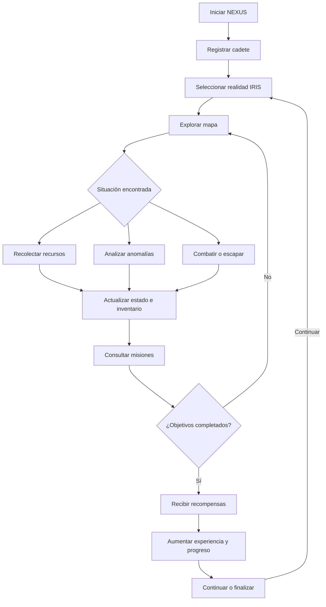

# Diseño del juego NEXUS

## 1. Visión del juego

NEXUS es un juego de exploración, supervivencia y combate ambientado en realidades desconocidas. El jugador controla a un cadete encargado de explorar sectores IRIS, investigar anomalías, recolectar recursos y enfrentarse a entidades peligrosas.

La experiencia se basa en tomar decisiones, administrar recursos y completar misiones. El jugador deberá cuidar la energía, la estabilidad y el escudo para sobrevivir durante las expediciones.

La motivación principal será descubrir nuevas anomalías, conseguir objetos, ganar experiencia y completar misiones. Como evolución, se propone diferenciar más las realidades y registrar los descubrimientos realizados, dando mayor profundidad a la exploración.

## 2. Ciclo principal de juego

El ciclo principal describe el desarrollo de una partida, desde el registro del cadete hasta la exploración, el cumplimiento de misiones y la progresión.



El jugador selecciona una realidad y explora su mapa. Durante el recorrido puede encontrar recursos, anomalías o enemigos. Estas situaciones afectan sus recursos y pueden contribuir al cumplimiento de las misiones. Al completar los objetivos, recibe las recompensas correspondientes y puede continuar explorando.

Como mejora propuesta, se plantea conservar el progreso y los descubrimientos para futuras sesiones.

## 3. Mecánicas y reglas

### 3.1. Exploradores y atributos

El personaje principal es el cadete, representado por la clase `Cadete`, que hereda de la clase abstracta `Personaje`.

Sus atributos principales son:

- **Energía:** representa su capacidad para sobrevivir. Si llega a cero, puede producirse el fin de la partida.
- **Estabilidad:** representa el estado del enlace con la realidad.
- **Escudo:** ayuda a reducir el daño recibido.
- **Experiencia:** refleja el progreso obtenido.
- **Rango:** se calcula según la experiencia acumulada y la regla implementada en el código.

Como mejora, se propone mostrar estos atributos de manera más clara y conservar el progreso del cadete.

### 3.2. Mapas y exploración

El código actual permite explorar las realidades IRIS-01, IRIS-02 e IRIS-03 mediante mapas representados con símbolos. El movimiento se realiza con WASD o las flechas del teclado.

Los costes de movimiento definidos incluyen montaña (`^`), con 3 unidades; agua (`~`), con 2; bosque (`#`), con 1; y corriente (`≈`), con 1. Otros terrenos no tienen coste adicional definido por estas reglas.

Durante la exploración pueden aparecer eventos aleatorios, recursos y encuentros.

Como mejora, se propone dar características particulares a cada realidad, con peligros y descubrimientos que hagan que las decisiones del jugador tengan mayor importancia.

### 3.3. Energía y supervivencia

El jugador debe administrar la energía, la estabilidad y el escudo para mantenerse preparado ante los peligros. Puede utilizar objetos y habilidades disponibles para recuperarse o protegerse.

Como mejora, se propone mostrar advertencias cuando los recursos estén en niveles peligrosos.

### 3.4. Combate y entidades

El cadete puede atacar, analizar situaciones, utilizar objetos e intentar escapar según las opciones disponibles. El robot dispone de una defensa que reduce el daño recibido en un 60 %.

Como evolución, se propone registrar los encuentros importantes, sus resultados y los recursos utilizados.

### 3.5. Inventario y objetos

El inventario permite consultar y utilizar objetos. Los tipos definidos incluyen célula de energía, escudo, módulo de ataque, analizador, núcleo de resonancia y módulo desconocido.

El núcleo de resonancia cuenta con una protección que impide eliminarlo antes de completar la misión correspondiente.

Como mejora, se propone mostrar la función y la cantidad de cada objeto, respetando las reglas actuales de uso.

### 3.6. Misiones y progresión

El sistema actual muestra títulos, descripciones, objetivos y progreso de las misiones. Al completar una misión, el cadete puede recibir experiencia y un módulo desconocido como recompensa.

Como mejora, se propone conservar el estado de las misiones y las recompensas para poder continuar el progreso en futuras sesiones.

### 3.7. Anomalías y descubrimientos

El jugador puede analizar anomalías durante la exploración. Como mejora, se propone crear un registro que almacene los descubrimientos, la realidad donde se encontraron y su estado de investigación. Esto permitiría consultar hallazgos anteriores y dar mayor profundidad a las expediciones.

## 4. Diseño de pantallas

Los siguientes prototipos son bocetos de organización para la interfaz de consola. Representan una propuesta de diseño y no funciones nuevas ya implementadas.

### 4.1. Menú principal

```text
+------------------------------------------------+
|                 NEXUS SYSTEM                   |
|            EXPLORACION DE REALIDADES           |
+------------------------------------------------+
|                                                |
|             [1] NUEVA EXPEDICION               |
|             [2] CONTINUAR PARTIDA              |
|             [3] REGISTRO DE EXPLORACION        |
|             [4] SALIR                          |
|                                                |
+------------------------------------------------+
```

**Elementos visibles:** título del sistema y opciones numeradas.

**Navegación:** el jugador selecciona una opción mediante el teclado. Continuar partida y registro de exploración se implementarán como mejoras futuras.

### 4.2. Exploración o mapa

```text
+------------------------------------------------+
| NEXUS              REALIDAD IRIS-01             |
+------------------------------------------------+
| ENERGIA: 85/100      ESTABILIDAD: 72             |
| ESCUDO: 20           RANGO: 1                   |
+------------------------------------------------+
|                                                |
|     . . # # . . . .                            |
|     . . # . ? . . .                            |
|     . . . . @ . . .                            |
|     ~ ~ . . . ^ . .                            |
|     . . ◆ . . . . .                            |
|                                                |
+------------------------------------------------+
| [I] INVENTARIO  [M] MISIONES  [Z] ANALIZAR      |
| [L] LEYENDA     [Q] SALIR                       |
+------------------------------------------------+
```

**Elementos visibles:** nombre de la realidad, mapa, estado del cadete y controles.

**Navegación:** el jugador se desplaza con WASD o las flechas y utiliza las teclas indicadas para consultar el inventario, las misiones o la leyenda, o para analizar anomalías.

### 4.3. Misiones

```text
+------------------------------------------------+
|                   MISIONES                     |
+------------------------------------------------+
| MISION ACTIVA                                   |
| Investigar una anomalia                         |
|                                                |
| Objetivo: localizar y analizar la anomalia      |
| Progreso: segun los objetivos de la mision      |
| Recompensa: experiencia y objeto                |
|                                                |
| [1] VER DETALLES                                |
| [2] VOLVER AL MAPA                              |
+------------------------------------------------+
```

**Elementos visibles:** nombre de la misión, descripción, objetivos, progreso y recompensas.

**Navegación:** el jugador consulta la misión y regresa al mapa para continuar la exploración. Los detalles concretos deberán corresponder a las misiones existentes.

### 4.4. Explorador e inventario

```text
+------------------------------------------------+
|             ESTADO DEL EXPLORADOR              |
+------------------------------------------------+
| Nombre: Cadete                                  |
| Realidad: IRIS-01                               |
| Energia: 85          Estabilidad: 72            |
| Escudo: 20           Experiencia: 150           |
+------------------------------------------------+
| INVENTARIO                                      |
|                                                |
| [1] Celula de energia                           |
| [2] Escudo                                      |
| [3] Modulo de ataque                            |
| [4] Analizador                                  |
|                                                |
| Seleccione un objeto para utilizarlo.           |
| [0] VOLVER                                      |
+------------------------------------------------+
```

**Elementos visibles:** información del cadete, atributos, objetos y opciones de selección.

**Navegación:** el jugador selecciona un objeto para consultar su función o utilizarlo si las reglas lo permiten, y después regresa a la exploración.

Los valores de los ejemplos son ilustrativos.

## 5. Experiencia de usuario

- **Legibilidad:** utilizar textos claros, espacios adecuados y colores que faciliten distinguir títulos, opciones y alertas mediante letras estilo ASCII.
- **Jerarquía visual:** destacar el estado del cadete y los títulos, dejando la información secundaria en posiciones menos prominentes.
- **Consistencia:** mantener los mismos nombres, símbolos, colores y controles para las mismas acciones.
- **Facilidad de navegación:** ordenar las opciones e indicar cómo volver a los menús anteriores.
- **Retroalimentación:** mostrar mensajes claros al utilizar objetos, recibir daño, completar misiones o descubrir anomalías.
- **Prevención de errores:** validar las opciones introducidas y respetar las restricciones del inventario para evitar acciones no permitidas.

## 6. Alcance y restricciones

### Funcionalidades prioritarias

Se conservarán y mejorarán las funciones existentes:

- Exploración de mapas y realidades IRIS.
- Gestión de energía, estabilidad, escudo y experiencia.
- Encuentros y combate.
- Inventario y uso de objetos.
- Misiones, objetivos y recompensas.
- Análisis de anomalías y eventos aleatorios.

Después se propone desarrollar un registro de descubrimientos, un historial de encuentros y un sistema de guardado del progreso.

### Funcionalidades opcionales

Si el tiempo disponible lo permite, se podrán incorporar estadísticas de expediciones, filtros para consultar descubrimientos y eventos adicionales para diferenciar las realidades.

### Restricciones

- El proyecto seguirá siendo una aplicación de consola desarrollada en C#.
- La navegación y las acciones se realizarán mediante el teclado.
- Se conservará la lógica existente, evitando reescribir el juego innecesariamente.
- Las mejoras se implementarán por etapas para facilitar las pruebas.
- El registro persistente y la recuperación del progreso se consideran mejoras futuras, no funciones ya implementadas.
- Se evitarán tecnologías externas y complejidades que no sean necesarias para los objetivos del proyecto.
